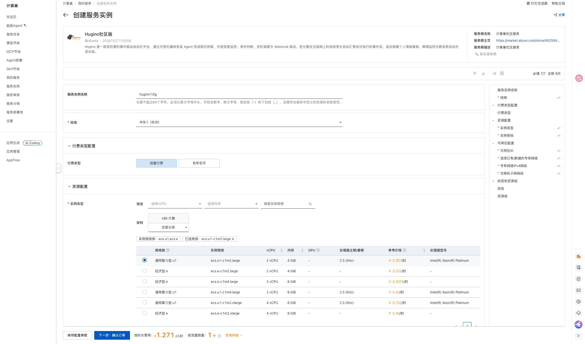
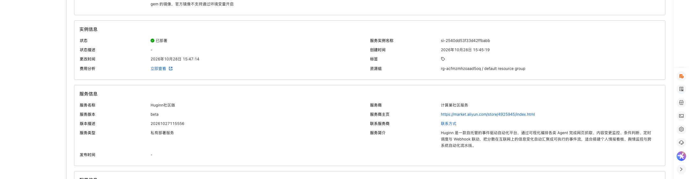

# Huginn 计算巢部署文档

## 概述

Huginn 是一款可自托管的事件驱动自动化平台（IFTTT/Zapier 的开源替代），通过可视化编排各类 Agent 完成网页抓取、内容变更监控、条件判断、定时调度与 Webhook 联动，把分散在互联网上的信息变化自动汇聚成可执行的事件流。

| 项目 | 说明 |
| --- | --- |
| 服务 ID | `service-7c3683ff963149759176` |
| 上游仓库 | [Huginn](https://github.com/huginn/huginn) |
| 部署形态 | 单台 ECS + Docker Compose |
| 访问方式 | 公网访问（端口 3000） |
| 实测部署耗时 | 约 2 分钟 |

## 部署步骤

### 1. 打开创建页面

访问 [Huginn 服务实例创建页](https://computenest.console.aliyun.com/service/instance/create/cn-hangzhou?type=user&ServiceId=service-7c3683ff963149759176)。

### 2. 配置部署参数

| 参数 | 说明 | 建议 |
| --- | --- | --- |
| 服务实例名称 | 控制台中用于识别本次部署 | 保持默认或自定义 |
| 地域、可用区 | ECS 所在位置 | 选择接近使用者且有库存的地域和可用区 |
| 付费类型 | 按量付费或包年包月 | 测试使用按量付费 |
| 实例类型 | ECS 规格 | 页面提供的通用算力型 u1 规格 |
| 管理员账号 | 内置管理员用户名为 `admin` | 部署完成后在服务实例详情页「立即使用」区域查看 `AdminSeedPassword` |
| 注册邀请码 | 新用户注册时必须填写 | 部署完成后在详情页「立即使用」区域查看 `HuginnInvitationCode` |
| 实例密码 | ECS 登录密码 | 使用符合页面规则的强密码 |
| 专有网络 | 新建或复用 VPC | 首次部署可选择新建 |
| VPC/交换机网段 | 网络地址范围 | 无冲突时保持默认 |

管理员密码与注册邀请码均由平台在部署时随机生成，请在服务实例详情页「立即使用」区域查看；请勿写入文档、截图或代码仓库。

填写完成后页面底部会显示实时价格，点击「下一步：确认订单」，核对资源与费用，勾选服务协议并创建实例。

### 3. 等待部署完成

进入服务实例详情页，等待状态变为「已部署」（本次实测约 2 分钟）。

### 4. 进入应用

在实例详情页「立即使用」区域打开访问地址，或直接访问 `http://<公网IP>:3000`。

打开访问地址后使用用户名 `admin` 与管理员密码登录，在首页点击 View 进入 Agents 列表即可创建网页抓取、内容监控与定时触发类 Agent；新成员注册需要填写注册邀请码。

## 数据与安全

- 应用端口 3000 对公网开放且自带账号体系；生产环境建议在安全组中收敛来源 IP，并配置 HTTPS 反向代理。
- 服务以 HTTP 对外提供，Huginn 会把「记住我」Cookie 标记为 secure，因此该功能在 HTTP 下不可用，属预期行为；如需启用请在实例前置 HTTPS 反向代理并把 `FORCE_SSL` 设为 true。
- 按上游信任模型，Agent 默认可访问其拥有者配置的任意主机（含内网）；如需禁止访问私网与元数据地址，请在实例 `/opt/huginn/.env` 中为 web 与 threaded 两个服务同时设置 `ENABLE_SMOKESCREEN=true` 后执行 `docker compose up -d`。
- 出厂未配置 SMTP，邮件通知类 Agent 与密码找回邮件不可用，抓取监控与 Webhook 联动不受影响；如需启用请在 `/opt/huginn/.env` 追加 `SMTP_SERVER`、`SMTP_PORT`、`SMTP_DOMAIN`、`SMTP_AUTHENTICATION`、`SMTP_USER_NAME`、`SMTP_PASSWORD`、`EMAIL_FROM_ADDRESS` 后执行 `docker compose up -d`。
- MySQL 数据保存在 Docker 命名卷 `huginn_mysql_data` 中，重建容器不会丢失；只有执行 `docker compose down -v` 才会删除数据。删除服务实例会一并删除实例与数据，请提前备份。
- 调度时区已设为 Asia/Shanghai，界面语言为英文；官方镜像不支持通过环境变量切换中文界面。

## 资源释放

不再使用时，在计算巢服务实例详情页执行「删除」。删除完成后建议继续确认：

1. 服务实例已不存在；
2. ROS 资源栈状态为 `DELETE_COMPLETE`；
3. ECS、VPC、交换机和安全组均无残留；
4. 账单中不再产生相关按量资源费用。

删除服务实例会同时删除 ECS 及其本地数据，请提前导出或备份重要文件与配置。

## 官方链接

- [Huginn 官方仓库](https://github.com/huginn/huginn)
- [Huginn 项目介绍](https://github.com/huginn/huginn#readme)

- [阿里云计算巢文档](https://help.aliyun.com/zh/compute-nest/)
